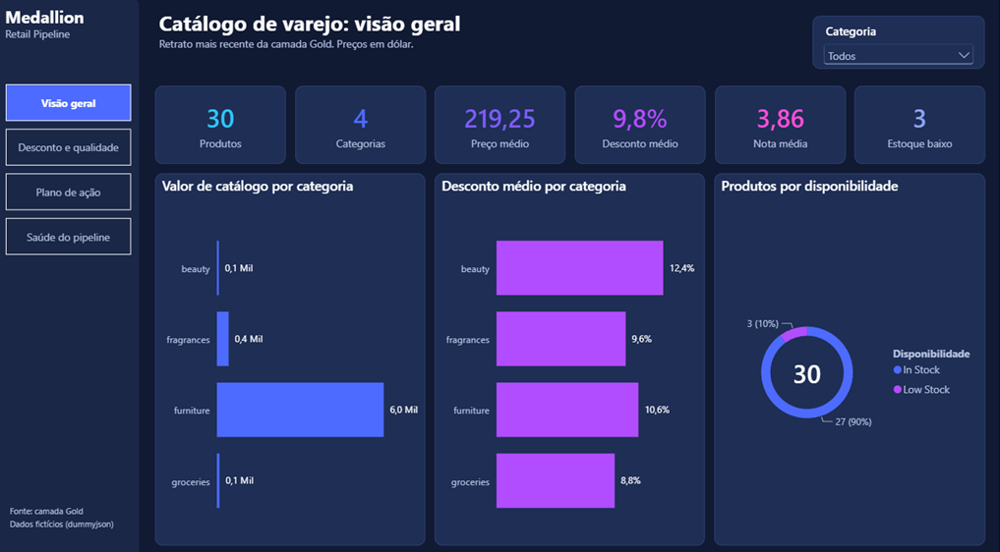
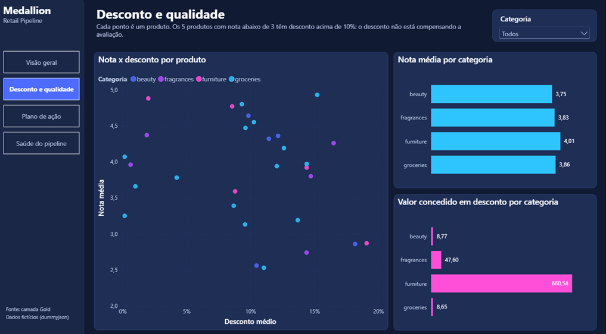
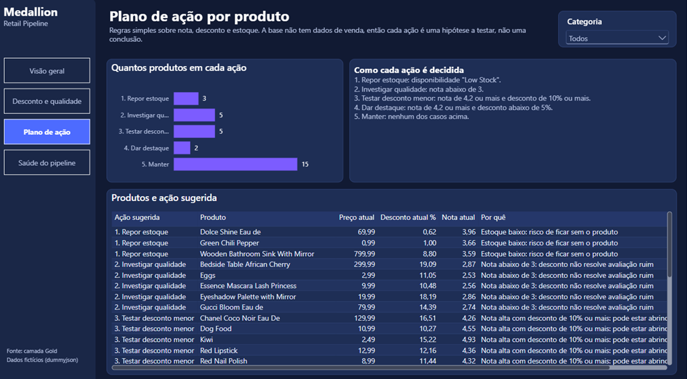
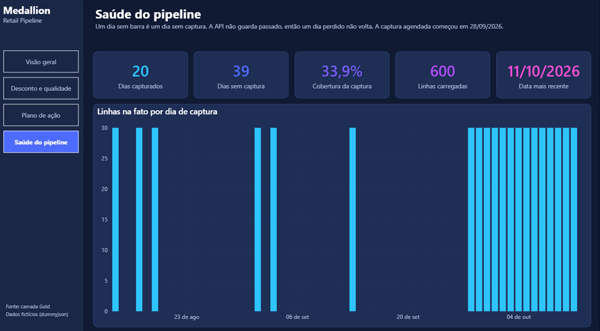

# 🏅 Medallion Retail Pipeline

## 📖 Sobre o Projeto
Pipeline de dados ponta a ponta usando Python, SQL, AWS, Apache Airflow e Power BI, baseado na **Arquitetura Medallion** (Raw, Bronze, Silver e Gold).

Este projeto extrai dados de produtos da API pública [dummyjson.com](https://dummyjson.com) e processa essas informações através de camadas progressivas de qualidade de dados, culminando em um modelo dimensional (Star Schema) consumido por um dashboard em Power BI. Os dados são fictícios (30 produtos por dia): o foco do projeto está na arquitetura e nas decisões de engenharia, não no volume.

---

## 🏗️ Arquitetura de Dados (Medallion)

O pipeline foi estruturado seguindo o padrão da indústria de camadas lógicas:

* **Ingestion (Raw):** Extração via AWS Lambda, disparada todo dia às 21h (horário de São Paulo) pelo EventBridge Scheduler, que salva o JSON bruto da API particionado por data no S3, evitando *Data Swamp*. A partição usa o fuso `America/Sao_Paulo`, para refletir o dia do negócio no Brasil. O script `extract_products.py` cobre a mesma extração para uso local em desenvolvimento.
* **🥉 Bronze Layer:** Carga (Load) dos dados brutos do S3 no PostgreSQL, garantindo um espelho exato da origem e proteção contra duplicatas (`ON CONFLICT DO NOTHING`). É *append-only*: cada carga é guardada junto com o nome do arquivo de origem (`source_file`), formando o histórico completo de tudo o que entrou no pipeline.
* **🥈 Silver Layer:** Transformação (ELT) usando o motor do banco de dados para limpeza, padronização de categorias, tratamento de campos JSONB e remoção de nulos.
* **🥇 Gold Layer:** Modelagem Dimensional (*Star Schema*). `dim_category` e `dim_product` (SCD Tipo 1, sempre com o atributo mais recente do produto) e a tabela fato `fact_product_snapshot`, granular por produto e por dia de snapshot, com métricas de preço, desconto, avaliação e status de disponibilidade.

---

## 🧠 Decisões de Modelagem (Gold)

* **Chave composta em `fact_product_snapshot` (`snapshot_date`, `product_id`):** o mesmo produto aparece uma vez por dia de snapshot, então a granularidade exige as duas colunas na PK.
* **`NUMERIC` em vez de `FLOAT` para valores monetários:** evita erro de arredondamento em `price` e `discount_percentage`.
* **`availability_status` na fato, não na dimensão:** é um dado que pode mudar de um dia para o outro, diferente de atributos fixos do produto.
* **`DO NOTHING` na carga da fato, `DO UPDATE` nas dimensões:** um snapshot já gravado é histórico e não deve ser reescrito; a dimensão (SCD Tipo 1) sempre reflete o estado mais recente do produto.
* **`rating` como coluna única em `silver.products`:** a API de origem retorna a nota como número direto, sem separar nota e contagem de avaliações.

---

## 🛠️ Tecnologias e Ferramentas

* **Linguagem:** Python 3
* **Banco de Dados:** PostgreSQL no Amazon RDS
* **Bibliotecas Principais:** `psycopg2`, `requests`, `boto3`, `logging`
* **Cloud:** AWS Lambda + S3 (camada Raw), EventBridge Scheduler (agendamento) e Amazon RDS (Data Warehouse)
* **Orquestração:** agendamento diário da extração via EventBridge Scheduler; Apache Airflow 3 (Docker Compose) para Bronze → Silver → Gold, com agendamento diário e *backfill*
* **Práticas Adotadas:** Idempotência, Tratamento de Exceções, Logs de Execução, SQL DDL/DML, Modelagem Relacional.

---

## 🚀 Estrutura do Repositório

```text
medallion-retail-pipeline/
├── airflow/
│ ├── dags/
│ │ └── medallion_retail.py # DAG diaria: bronze -> silver -> gold
│ ├── docker-compose.yaml # Airflow 3 com LocalExecutor
│ ├── docker-compose.codespaces.yaml # Ajuste de rede para o GitHub Codespaces
│ └── .env.example
├── dashboard/
│ ├── MedallionRetail.pbip # Projeto Power BI (abrir este arquivo)
│ ├── MedallionRetail.SemanticModel/ # Modelo: tabelas, relacionamentos e medidas DAX
│ ├── MedallionRetail.Report/ # Paginas e visuais do relatorio
│ ├── data/ # Extrato da gold em CSV (fonte do relatorio)
│ └── img/ # Imagens das paginas
├── data/
│ └── raw/ # JSONs brutos extraidos da API (versionamento ignorado)
├── infra/
│ └── aws/
│ └── lambda_handler.py # Handler AWS Lambda
├── logs/
│ └── app.log # Log unico de execucao do pipeline
├── src/
│ ├── database/
│ │ └── create_schemas.py # DDL: schemas bronze/silver/gold e tabelas
│ ├── extract/
│ │ └── extract_products.py # Extracao da API -> data/raw
│ ├── export/
│ │ └── export_gold.py # Extrato da gold em CSV para o dashboard
│ ├── load/
│ │ └── load_bronze.py # Ingestao do JSON bruto no PostgreSQL
│ └── transform/
│ ├── transform_silver.py # Limpeza e padronizacao (ELT)
│ └── build_gold.py # Star Schema (dimensoes + fato)
├── tests/ # Reservada para testes automatizados (ainda vazia)
├── requirements.txt # Dependencias do projeto
├── .gitignore
└── README.md
```

---

## ⚙️ Configuração

### 1. Dependências

```bash
python -m venv .venv
.venv\Scripts\activate          # Windows
# source .venv/bin/activate     # Linux/macOS
pip install -r requirements.txt
```

### 2. Variáveis de ambiente

Nenhuma credencial ou nome de recurso fica no código. Os scripts leem estas variáveis:

| Variável | O que é |
|---|---|
| `DB_HOST` | Endpoint do PostgreSQL (ex.: `<instancia>.<id>.us-east-1.rds.amazonaws.com`) |
| `DB_USER` | Usuário do banco |
| `DB_PASSWORD` | Senha do banco |
| `BUCKET_NAME` | Nome do bucket S3 da camada Raw (o mesmo configurado na Lambda) |

```powershell
# PowerShell (vale só para a sessão atual do terminal)
$env:DB_HOST = "..."
$env:DB_USER = "..."
$env:DB_PASSWORD = "..."
$env:BUCKET_NAME = "..."
```

```bash
# Bash
export DB_HOST="..." DB_USER="..." DB_PASSWORD="..." BUCKET_NAME="..."
```

A Lambda usa a mesma variável `BUCKET_NAME`, configurada no próprio console da AWS.

### 3. Credenciais AWS

O `load_bronze.py` lê o arquivo do dia direto do S3 via `boto3`, então a máquina precisa de credenciais AWS configuradas (`aws configure`) com permissão de leitura no bucket.

### 4. Acesso de rede ao RDS

O security group da instância RDS só libera a porta `5432` para IPs específicos (`/32`). Se a conexão falhar com `Connection timed out`, o IP público da máquina provavelmente mudou (internet residencial costuma ter IP dinâmico): atualize a regra de entrada do security group com o IP atual. Nunca libere `0.0.0.0/0`.

---

## ▶️ Ordem de Execução

```bash
python -m src.database.create_schemas    # 1. cria schemas e tabelas (idempotente)
python -m src.load.load_bronze           # 2. carrega o JSON do dia (S3) na camada bronze
python -m src.transform.transform_silver # 3. limpa e padroniza -> silver
python -m src.transform.build_gold       # 4. monta o star schema -> gold
```

O `load_bronze` aceita uma data opcional para carregar um dia anterior: `python -m src.load.load_bronze 2026-10-01`. Sem a data, vale o dia atual em São Paulo.

A extração diária para o S3 é feita pela Lambda (`infra/aws/lambda_handler.py`), agendada no EventBridge Scheduler:

| Parâmetro | Valor |
|---|---|
| Expressão | `cron(0 21 * * ? *)` (todo dia às 21h00) |
| Fuso horário | `America/Sao_Paulo` |
| Payload | `{"endpoint": "products"}` |
| Retentativas | 3, dentro de uma janela de 24h |

O horário de 21h deixa o dia de negócio praticamente fechado e ainda sobra folga antes da virada do dia. As camadas Bronze, Silver e Gold podem ser executadas manualmente, na ordem acima, ou pelo Airflow (próxima seção).

O `src.extract.extract_products` faz a mesma extração salvando em `data/raw`, apenas para desenvolvimento local; ele não alimenta a Bronze.

---

## 🌬️ Orquestração com Airflow

A DAG `medallion_retail` (`airflow/dags/medallion_retail.py`) executa as três camadas em sequência, chamando a função `run()` de cada script:

```text
load_bronze -> transform_silver -> build_gold
```

| Parâmetro | Valor |
|---|---|
| Agendamento | `30 21 * * *`, fuso `America/Sao_Paulo` |
| Retentativas | 2, com 10 minutos de intervalo |
| Execuções simultâneas | 1 |

* **Por que 21h30:** a captura da Lambda roda às 21h com retentativas. A meia hora de folga evita processar um dia cujo arquivo ainda não chegou no S3.
* **Se uma task falha, as seguintes não rodam:** a Gold nunca é montada em cima de uma Silver que deu erro.
* **Data da carga:** cada execução carrega o arquivo do seu próprio dia, não o de "hoje". O Airflow guarda as datas em UTC, e 21h30 em São Paulo já é o dia seguinte em UTC, então a DAG converte a data para o fuso de São Paulo antes de procurar a partição no S3.

### Subindo o ambiente

O `docker-compose.yaml` é baseado no oficial do Airflow 3.3.2, enxuto para `LocalExecutor` (as tasks rodam dentro do scheduler). É uma configuração de desenvolvimento.

```bash
cd airflow
cp .env.example .env                 # ajuste o AIRFLOW_UID com o resultado de: id -u
mkdir -p dags logs plugins config
docker compose up airflow-init       # so na primeira vez: prepara o banco interno e cria o usuario
docker compose up -d
```

A interface fica em `http://localhost:8080` (usuário e senha padrão: `airflow`). As variáveis `DB_HOST`, `DB_USER`, `DB_PASSWORD`, `AWS_ACCESS_KEY_ID`, `AWS_SECRET_ACCESS_KEY`, `AWS_DEFAULT_REGION` e `BUCKET_NAME` precisam existir no terminal que roda o `docker compose`: ele repassa os valores para os containers, sem gravá-los em arquivo.

No GitHub Codespaces, mantenha a linha `COMPOSE_FILE` do `.env.example`: lá os containers só conversam entre si pela rede padrão do Docker, e o `docker-compose.codespaces.yaml` faz esse ajuste. Fora do Codespaces, remova essa linha. O IP de saída do Codespace também precisa estar liberado no security group do RDS.

### Backfill

Para reprocessar dias anteriores cujo arquivo já está no S3:

```bash
docker compose exec airflow-scheduler airflow backfill create \
  --dag-id medallion_retail \
  --from-date 2026-09-30T00:00:00-03:00 \
  --to-date 2026-10-10T23:59:59-03:00 \
  --max-active-runs 1
```

Um dia sem arquivo no S3 falha com `FileNotFoundError`, de propósito: é o sinal de que a captura daquele dia se perdeu. Para reprocessar um dia que já rodou com sucesso, acrescente `--reprocess-behavior completed`.

O arquivo de 13/08/2026 é anterior à troca da fonte para a dummyjson e está em outro formato, então a carga desse dia falha na Bronze e as camadas seguintes não rodam.

### Limitação atual

O Airflow roda em ambiente de desenvolvimento (Docker Compose), que não fica ligado 24 horas. Enquanto ele está de pé, a DAG dispara sozinha às 21h30; os dias em que ele esteve desligado são recuperados com *backfill*.

---

## 📊 Dashboard (Power BI)

Relatório em Power BI construído sobre a camada Gold, em 4 páginas:

| Página | Pergunta que responde |
|---|---|
| Visão geral | Como é o catálogo hoje: quantos produtos, preço, desconto, nota e disponibilidade |
| Desconto e qualidade | O desconto acompanha a avaliação do produto? |
| Plano de ação | O que fazer com cada produto: repor, investigar, rever desconto, destacar ou manter |
| Saúde do pipeline | Em quais dias houve captura e quantas linhas cada dia carregou |






### Como o plano de ação é decidido

Cada produto recebe uma ação por regras simples, avaliadas nesta ordem:

1. **Repor estoque:** disponibilidade `Low Stock`.
2. **Investigar qualidade:** nota abaixo de 3.
3. **Testar desconto menor:** nota de 4,2 ou mais e desconto de 10% ou mais.
4. **Dar destaque:** nota de 4,2 ou mais e desconto abaixo de 5%.
5. **Manter:** nenhum dos casos acima.

A fonte não tem dados de venda, então cada ação é uma hipótese a testar, não uma conclusão. E como a dummyjson devolve sempre os mesmos valores, preço, desconto e nota não mudam de um dia para o outro: por isso o relatório mostra o retrato mais recente, e a única página com evolução no tempo é a de saúde do pipeline.

### Como abrir

1. Gere o extrato da Gold (precisa das variáveis `DB_*`):
   ```bash
   python -m src.export.export_gold
   ```
2. Abra `dashboard/MedallionRetail.pbip` no Power BI Desktop.
3. Em **Transformar dados > Editar parâmetros**, aponte `DataFolder` para a pasta `dashboard/data` na sua máquina e clique em **Atualizar**.

O relatório lê os CSV em vez de conectar direto no RDS porque o Power BI exige conexão criptografada e o Windows não confia, por padrão, na autoridade certificadora do RDS. O extrato evita instalar certificado na máquina e deixa o relatório abrível por qualquer pessoa, sem acesso ao banco.

O projeto está no formato `.pbip` (texto), e não `.pbix` (binário), para que modelo, medidas DAX e páginas fiquem versionados e legíveis no Git.

---

## 🔁 Recuperação de Carga Perdida

O pipeline é incremental e diário. Existem dois tipos de falha, com consequências diferentes:

* **Faltou o arquivo no S3 (falha na captura):** a API devolve apenas o estado atual dos produtos, então o retrato de um dia que não foi capturado **não pode ser recuperado depois**. Por isso a captura roda na nuvem, agendada, com retentativas automáticas.
* **O arquivo está no S3, mas não foi processado:** nada se perde. O `load_bronze.py` recebe a data que deve carregar, e o *backfill* do Airflow passa para cada execução o seu próprio dia. Como as cargas são idempotentes, reprocessar um dia já carregado não duplica nada.

---

## 🚧 Limitações e próximos passos

O que o projeto **não** faz hoje, de propósito ou por enquanto:

* **Não roda 24 horas por dia por inteiro.** A captura (Lambda) roda sempre; o Airflow roda em ambiente de desenvolvimento e recupera os dias parados com *backfill*.
* **Não tem testes automatizados.** A validação é feita por contagem de linhas no banco a cada camada (por exemplo, reprocessar um dia já carregado insere 0 linhas).
* **Não usa dados reais nem de venda.** A fonte é a dummyjson, com valores fictícios que não mudam de um dia para o outro.

Próximos passos: testes automatizados, Airflow em um servidor que fique ligado 24 horas e transformações com dbt.
